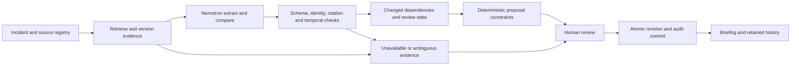

# Agentic application architecture

Status: final implementation blueprint with partial local evidence and durable-run foundations. Owner-priced provider transports now exist locally; manual worker dispatch and source-to-draft interpretation now have synthetic local integration evidence; actual scheduler/account execution and complete authenticated acceptance remain pending. No expert transcript exists; domain judgments below are hypotheses linked to [discovery](DOMAIN_DISCOVERY.md).

**Shape:** one deterministic durable workflow with bounded model steps, verified tools, and a human decision boundary. Hold ambiguous output for review. Model escalation is a later measured extension; the current worker does not escalate or retry provider calls. The model emits structured claims and explanations; deterministic code owns permissions, clocks, jobs, constraints, persistence and approval checks.

[Product requirements](PRODUCT_REQUIREMENTS.md) own supported scope. This document owns modules, persistence, concurrency, runtime and numerical ceilings. The inherited Workflow runtime is the first worker candidate, subject to new-target tests; no additional agent framework or GPU service is required.

| Node | Owns | Persisted output | Verification / failure |
| --- | --- | --- | --- |
| Admission | Actor/incident scope, mode, registry and budget revision | Run identity and captured config | Reject cross-scope or unsupported source requests |
| Retrieval | Tavily requests, bounded extract, public structured feeds | Retrieval events and immutable document versions | URL/payload/issuer/time validation; incomplete outcomes held, no automatic provider retry |
| Interpretation | Source-local extraction and old/new semantic comparison | Typed claims, cited changes and uncertainty | Schema/citation checks; unsupported claims held |
| Applicability | Entity/jurisdiction/effective interval and conflict checks | Accepted or needs-review claim status | Ambiguity never silently becomes accepted |
| Dependency review | Claim/source links and plan validity | Dependency revision, affected items, incident generation | Incident-wide approval fence opens before classification; unresolved dependencies remain blocked |
| Proposal | Crew/task constraints and deterministic alternatives | Draft plan revision and constraint report | Infeasible/missing estimates remain explicit |
| Human decision | Accept/modify/reject/annotate with reason | Decision and immutable evidence vector | Current role, clock, generation and revision checked at commit |
| Export | Authorized complete briefing from one committed revision | Artifact hash and completion receipt | Stop partial delivery; preserve public redaction |

**Run state:** queued -> retrieving -> interpreting -> validating -> ready_for_review -> completed. Additional terminal states: canceled, failed, budget_stopped. A transient failure may resume the same run at its saved checkpoint, within the same fixed deadline and reserved budget. ready_for_review is a computational publication stage; completed means results were durably published. It never waits for a human within the 120-second run deadline or implies plan approval. Human review has its separate plan/decision lifecycle.

**Plan state:** draft -> ready_for_review -> approved / rejected / superseded. Evidence validity is a separate current/needs_review/unavailable projection. A previously approved revision remains approved historically while new evidence makes its current applicability needs_review. Revisions are immutable; modifications create a new revision. Never rewrite a past approval into a different decision.

**Memory:** working memory is run-local bounded evidence and typed intermediate output; durable reference memory is versioned source policy/tool schema/model config; episodic memory is explicit reviewed feedback/evaluation cases. Retain source versions and decision-time snapshots for audit. Do not persist raw private chain-of-thought or let unreviewed user/model feedback alter operational policy automatically. Structured rationale, source references and tool status are sufficient execution evidence.

**Reuse boundary:** preserve FireAfter's server authorization, source freshness, Unknown screening, command receipts, paging/redaction and audited actions. Add Sentinel services at narrow boundaries; avoid embedding model calls into scoring.ts or client components. Start from inherited workflows only after new-target schema/lease tests pass. One durable scheduler/worker owns continuation; browser polling reports progress and does not own job completion.

**Recovery:** failed retrieval preserves last successful content and original age; malformed output never promotes; failed draft publication leaves the previous complete revision; restart resumes a checkpoint with original timestamps/budgets; uncertain decisions reconcile receipts. Quarantine questionable versions and create a correction revision instead of deleting history.

**Observability:** log run/stage/trace IDs, source IDs, config/model/prompt versions, elapsed time, request/byte/token usage, verifier outcomes, fallback/escalation, conflict and human overrides. Apply role redaction to traces. Metrics and source text are separated so routine logs avoid sensitive content.

## Verified reuse and new seams

FireAfter's source pkg.json provided structural navigation during the read-only baseline inspection. Focused source reads confirmed src/lib/auth.ts uses incident_commander, analyst and viewer; src/workflows/ingestion.ts already uses the workflow package; src/lib/ingestion-worker.ts already calls leased ingestion RPCs. These are reuse patterns, not fresh runtime acceptance. Sentinel's pkg.json now has this checkout's identity, final document catalog and implemented Sentinel helper/SQL nodes. Other inherited semantic/runtime edges remain provisional. The retained Graphify extraction covers code/config/test structure and real directory membership, excluding SQL/document semantics. Refresh it after coherent source edits and verify source hashes before runtime graph use. Do not infer hosted acceptance or complete workflow behavior from either map.

| Implementation seam | Responsibility | Reuse / verification |
| --- | --- | --- |
| src/lib/sentinel/contracts.ts | Bounded request/response schemas, modes, error enums and normalized model output | Existing validation conventions; malformed/unknown fields rejected |
| src/lib/sentinel/native-provenance.ts | Fresh-adapter acquisition seals and exact stored-row mode binding | Independent app/database signing key; direct/staged transport and hydration exercised locally; fresh-target/concurrent qualification pending |
| src/lib/sentinel/providers.ts | Server-only Tavily and Token Factory adapters; response limits, usage receipts and aborts | Ordinary authenticated HTTP; no new SDK required solely for branding |
| src/lib/sentinel/evidence.ts | Normalization, immutable version identity, claim/citation checks, semantic review and comparisons | Existing source freshness semantics; never changes scoring.ts |
| src/lib/sentinel/store.ts | Scoped reads and narrow private RPCs; projection assembly; redaction | auth.ts and fireafter-supabase.ts patterns; real applied SQL tests |
| src/lib/sentinel/runs.ts | Durable checkpoints, leases, cumulative reservations and original deadlines | Ingestion-store/worker patterns; new records and RPCs kept separate |
| src/lib/sentinel/changes.ts and change-http.ts | Leased cited comparison drafts and private append-sequence reader | Draft lineage, scoped references, safe cursor and missingness; semantic acceptance remains separate |
| src/lib/sentinel/marker-reviews.ts | Human source-change preview, hold/resolve commands and immutable receipt binding | Current source, whole-version rights, claim-review vector, scope, role and generation fences; not plan approval |
| src/lib/sentinel/planning.ts and constraints.ts | Authored constraint schemas, exact two-crew assignment and immutable revision commands | Current asset scope, role/CAS/replay fences; assessment is constraints-only, not evidence/plan approval |
| src/lib/sentinel/plans.ts and plan-http.ts | Private proposal preview, draft persistence, immutable lineage and scoped history | Policy/admission preview, atomic decisions and reconciliation exist locally; the signed native bridge exists locally; real native/target qualification remains pending. Verification results belong to the decision register |
| src/workflows/sentinel.ts | Bounded workflow steps that call run checkpoints | Inherited workflow package 5.1.0; verify on chosen target without upgrading by assumption |
| src/app/api/sentinel/... | Thin authenticated Node runtime handlers | Current actions route and scoped access helpers; no provider calls in browser |
| src/components/sentinel/... | Changes, Evidence, Plan and Briefing views within existing shell | Existing styles/navigation; keyboard and unavailable states |
| supabase/migrations/<timestamp>_sentinel_<slice>.sql | Additive tables, scoped keys, policies and RPCs in coherent slices | Exact inherited migration order after fresh-target verification |

Use existing dependency versions and lockfile at import. New libraries need a concrete capability, maintenance/license justification and focused verification. Read installed Next.js guides before framework edits, as FireAfter AGENTS.md requires.

## Persistence groups

1. Evidence/state, implemented locally: sentinel_incident_state, sentinel_source_configs (immutable configuration revisions), sentinel_retrieval_events, sentinel_documents and sentinel_document_versions. Claims use sentinel_claims and sentinel_claim_publications; human judgments use sentinel_claim_reviews; comparison drafts use sentinel_changes and sentinel_change_publications. Source-marker reviews, invalidations and derived status use sentinel_marker_reviews, sentinel_marker_invalidations and sentinel_marker_status. Their semantic acceptance remains separate from mechanical citation/publication checks.
2. Execution, implemented locally: sentinel_org_runtime, sentinel_runs, sentinel_run_commands, sentinel_provider_reservations and sentinel_run_checkpoints. These reservations retain attempted-call limits and settled usage. sentinel_dispatch_attempts and sentinel_dispatch_receipts retain bounded scheduler admission/acknowledgment separately from the logical dispatch ID. sentinel_worker_outputs retains immutable, contiguous, SHA256-bound private stage frames. sentinel_provider_prices, sentinel_provider_funds and sentinel_priced_reservations add owner-managed current pricing, persistent cumulative currency/credit-or-token ceilings and immutable financial holds. Real account/pricing/tokenizer and concurrent-target qualification remain pending.
3. Planning source exists locally: sentinel_policies and sentinel_policy_commands now retain coordinator policy revisions/receipts; sentinel_constraints and sentinel_constraint_commands; proposal migration 20261012001000 adds sentinel_plans, sentinel_plan_revisions, sentinel_plan_items, sentinel_plan_dependencies, sentinel_plan_status and sentinel_plan_commands. Atomic human review decisions exist locally; operational/hosted acceptance remains pending. Decisions add sentinel_decisions, sentinel_command_receipts, sentinel_decision_status and sentinel_decision_audit, plus the derived current approved revision pointer. sentinel_briefings now persists immutable JSON and printable HTML with complete byte/hash receipts. sentinel_history_entries and scoped history_generation index committed plan/decision entries atomically; they never change evidence generation.
4. Native provenance, partial local implementation: sentinel_native_signing_keys stores owner-qualified, organization-scoped signing keys with finite validity and irreversible revocation. Migration 20261012011000 adds private HMAC verification and replaces the native admission label check; the shared fixture applies all seventeen exact Sentinel migrations. No signing key is configured or provisioned.
5. Reviewer signals, implemented locally: sentinel_feedback_observations appends an optional scoped correction in the review transaction; sentinel_permission_records retains owner-provisioned offline-purpose grants with irreversible revocation. Normal review does not require a learning grant. The existing decision audit retains a separate post-feedback admission check for acceptance; no immutable signal or decision is rewritten. No provider or policy/model promotion is performed.

The local publication migration additionally implements sentinel_document_heads (derived current pointer), sentinel_source_change_markers (immutable unresolved transition records) and sentinel_evidence_publications (immutable batch payload/receipt). Current full-text marker hold/resolve is implemented locally; historical/supersession and rejection/quarantine policy paths remain pending; source-to-comparison drafts exist locally, while real provider/domain qualification remains pending; durable comparison draft publication/readback is implemented locally; a separate human claim-review command is implemented locally. The batch permits at most five unique documents, 500 KiB aggregate normalized text and 1 MiB serialized observation JSON; escaped JSON can reach its transport ceiling before the text ceiling and is explicitly rejected. This private worker command does not change the 128 KiB browser mutation bound.

The source-registry migration adds sentinel_source_operators (owner-managed purpose admission) and sentinel_source_config_commands (immutable activation payload/receipt). Activation requires a current commander membership and source-operator admission, locks membership -> operator admission -> organization execution -> incident state -> runs, and checks the expected current configuration. Changed configuration increments evidence generation and fences active old-config workers without refunding outstanding reservations. An exact no-op retains the revision/generation; historical command replay does not reactivate old configuration. Stable document IDs/keys cannot be renamed. No browser/model activation endpoint or self-admission exists. Operator provisioning on a new target remains pending.

Local source mappings above cover the implemented Sentinel tables. The validator compares them with migration declarations; current totals and qualification belong to the decision register. The decision register owns qualification results and their exact source snapshots. Table existence is not functional acceptance. Proposed mappings describe the remaining target design. Use organization_id + incident_id + id composite uniqueness/references for cross-record joins; retain mode in references or verify it transactionally. Immutable document, claim, constraint, plan-content and decision rows cannot be updated/deleted by ordinary runtime roles. Review/validity status lives in append-only reviews plus mutable derived projections. sentinel_plan_status and current pointers are derived state, never the only record of a historical decision. Do not put a mutable state machine into supposedly immutable plan content.

## Scoped publication and review

Member reads hold membership and incident-state SHARE locks for a coherent generation. Current heads, latest active-configuration retrieval checks and human judgments are distinct projections. Previous-configuration heads remain historical. Append-sequence cursors handle timestamp ties and carry no authority. [Data/API contracts](DATA_AND_API_CONTRACTS.md) own all record fields, endpoint shapes, paging/serialization limits and response codes; this section owns transaction behavior.

Evidence publication validates the registered identity, scope, hashes, retention and current worker lease. A meaningful version transition locks incident state, advances evidence generation and opens an unresolved marker before interpretation. Identical content/metadata adds a retrieval event without refreshing the immutable version's publication time. Partial/failed acquisition retains the last successful content and age and cannot become a complete check. Publication rechecks the lease after persistence; late results roll back.

Claim publication independently verifies exact UTF-8 spans and current incident asset candidates. Mechanical support leaves semantic support unreviewed. publishChanges binds drafts to the exact scoped version pair and cited claims; drafts remain semanticAccepted=false. New claims, human claim judgments and comparison drafts reopen affected resolved markers under the state lock, append invalidations and advance generation once. Exact command replay returns history without reactivation or reopening again.

Human marker resolution requires current whole-source/provenance attestations, current claim-review vectors and explicit materiality under generation/CAS fences. An unresolved human outcome or failed classifier keeps incident approval blocked. Current retained full-text hold/resolve is implemented; historical/supersession, restricted-retention, withdrawn/rejected/quarantined-source alternatives need reviewed policy and implementation. Rejecting a source must never authorize missing mandatory dependency coverage. Marker resolution is separate from plan approval.

## Constraints and immutable proposals

Operator-authored constraints preserve missing capability, duration, travel and interval values as null. planning.ts uses a deterministic complete subset search with a Pareto frontier of two crew end times. It explores ordering and eligible assignments under UTC minute-granularity windows and constant authored travel allowances. An independent validator requires every selected task exactly once with no overlap. No physical routing or inferred crew/hazard value exists. Allocation result: incomplete/infeasible output retains selected IDs and no partial assignment; missing data that could change impossibility remains incomplete. The read projection is authored_constraints_only.

Proposal creation captures immutable constraints/policy, selected assets/native fingerprints, all task-to-claim dependencies, source configuration/heads and the exact evidence generation/vector. It compares the current parent/revision fences and commits the complete draft, items, dependencies, pointer and command receipt atomically. Incomplete drafts retain all selected items with no assignments. Draft content stays state=draft and approvalReady=false; current review/approval validity is a separate projection. Replaying an old receipt cannot reactivate its pointer. Inherited asset/native writes may change fingerprints without advancing Sentinel generation, so a generation match alone never establishes eligibility.

## Evidence publication and decision protocol

1. Authenticate afresh and acquire the shared current-membership row lock first. Source activation additionally requires owner-provisioned operator admission. Runtime cannot self-enroll. Commander-only accept/reject and analyst/commander modify/annotate are checked in the private committing RPC, including replay.
2. Execution writers lock membership -> organization execution -> incident state -> run. Decision writers take native/asset SHARE barriers after membership, then incident state -> plan/current pointer -> command identity. A writer must not acquire an organization execution lock after incident state. Membership revocation conflicts with the shared lock held through commit; late workers cannot bypass lease fencing.
3. Accept compares current proposal, evidence generation/vector, constraints and policy. Require zero unresolved source markers, supported applicable dependencies and a feasible complete plan with every selected task assigned. Coordinator policies cover the entire active registry and retain explicit source age/required-time rules; they cannot weaken forecast/PWFDF safety floors. Missing/future/expired inputs remain blockers under the declared rules.
4. Validate live eligibility with the database wall clock after acquiring locks. Replay/synthetic uses the recorded scenario clock, while signing-key authority always uses actual wall time. Latest retrieval append order and exact native/asset fingerprints are included. Legacy or unsigned native data remains unbound. The preview's eligible flag attests only that instant and never grants an approval.
5. Commit the decision, retained decision-time snapshot, immutable audit/receipt and terminal status together, then rerun admission after persistence and append final_admission. A late failure rolls the whole transaction back. Original checkedAt/committedAt and finalValidation.checkedAt have different meanings; none proves continuous later validity or field execution.

Two competing terminal decisions cannot both commit for one revision. Modify creates a new complete draft requiring a subsequent commander accept. Reject may close an expired/infeasible current proposal; annotation may reference history. Exact same-key replay is historical under current authorization; altered payload conflicts. Scoped status not_observed never proves rollback. Real concurrent-session, deadlock, full-schema/auth and hosted acceptance remain unqualified.

Optional typed feedback appends atomically with its existing human review/decision, preserving the immutable original and separate final-admission check. Owner permission gates offline reuse, never ordinary review. History records append separately from evidence generation. JSON/HTML briefings retain one immutable revision and exact artifact bytes; role redaction and client byte/hash verification do not attest disk-save completion. [Data/API contracts](DATA_AND_API_CONTRACTS.md#portable-briefing-lineage) own complete lineage and permission fields.

## Job, dispatch and reservation protocol

POST runs atomically checks active-run admission, captures source configuration and initializes bounded cumulative counters. It sets one deadline and persists a workflow dispatch identifier; the local dispatcher now claims an invocation and records its separate SDK runtime ID; hosted dispatch remains unqualified. The worker must reserve each attempted call atomically before contacting a provider. Repeating the original admission command reconciles that same logical dispatch ID after failure; it cannot create a new budget or deadline or redispatch an uncertain provider attempt. The worker acquires an expiring lease with monotonically increasing fence; every checkpoint/result write verifies that fence.

Use the inherited Workflow runtime as the first candidate. Provider calls occur in bounded steps, with run/stage/attempt persisted before dispatch and results promoted once. Configure explicit retry behavior so runtime retries cannot multiply provider charges outside reservation accounting. Exactly-once provider charging is not assumed: an uncertain response retains its worst-case reservation and needs reconciliation. It cannot automatically call again as though the first attempt did not occur.

Keep transaction locks short: reserve/checkpoint, release, perform provider request, then validate/promote under a fresh lock. Never hold a database transaction open for model latency. Lease expiry permits takeover only within the original deadline; late worker results are fenced. Cancellation fences publication; UI reports cancellation pending until confirmed. Failed dispatch remains queued with diagnostics and a bounded retry path.

The implemented execution foundation serializes membership SHARE -> organization execution row -> incident-state row -> run row. Every execution writer uses that order; decision writers retain the earlier membership -> incident -> plan order and must not acquire an execution-row lock after incident state. Current leases last at most 30 seconds; explicit renewal requires the current owner/fence and cannot exceed the original run deadline. Same-owner acquire retries return the same lease. Attempt dispatch deadlines never increase when a lease is renewed. Up to two unsettled, unexpired attempts consume organization capacity, even if their run was canceled. Reserved counters are conservative totals, distinct from actual usage retained on settled attempts. These SQL rules have local applied tests; multiconnection/hosted locking and actual runtime dispatch remain unproven.

## Native acquisition and stored-row authority

The acquisition seal binds key/organization, incident alias, mode and a canonical content hash covering source identity, observed times, status, coverage, raw payload and derived signals. Missing publication times remain unknown. A stored-row binding then covers the database incident and exact stored projection, including freshness and payload; SQL compares it with the actual row and verifies HMAC using a currently valid, unrevoked owner key. Plain mode labels cannot qualify a snapshot. Signing does not prove source truth, completeness or operational applicability.

The private key table is inaccessible to runtime roles. The server signer uses separate Sentinel configuration; it never reads the database key table. Current default-adapter acquisition emits live mode. Replay/synthetic producers must have a separately qualified acquisition path and cannot relabel live data. No key means unbound evidence and held approval. A frame above 1 MiB remains stored in full without a binding; it is never truncated into authority. Key authority takes a SHARE lock through the caller transaction and checks actual wall time after the lock and after hashing, even when evidence uses a scenario clock. Real opposing-session revocation/acceptance races remain unqualified. Existing signed checkpoints retain their original observation times. This is a local implementation with synthetic integration coverage; the decision register owns executed checks and remaining qualification gates.

## Account-priced provider transport

Migration20261012010000 and provider-budget.ts join the original attempt to owner-qualified immutable pricing and cumulative account funds in one transaction. Fresh stored-run membership/lease and current source configuration remain mandatory. Runtime roles cannot create prices, grant funds, read raw funding tables or reset usage. Price fields bind provider/operation/exact model, finite validity and an authority-evidence hash. Funding has separate absolute ceilings for micro-USD and provider units: Tavily microcredits or Nemotron reserved tokens. Provider funds persist across runs, modes, cancellations, settlements and price revisions. Both token-price terms round upward independently; exact attempt replay never charges twice or grants another dispatch. Original reservations and financial holds remain charged conservatively; reported actual usage does not refund them. Owner funding changes are separate authorized database operations.

providers.ts sends only to fixed Tavily Search/Extract and Token Factory completion endpoints, with redirects disabled. Retrieval must use the original currently active run registry, never a supplied replacement URL list. Search uses reviewed issuer/jurisdiction metadata and remains discovery-only; new candidates need source admission. Extract accounts for every requested URL across results and failed_results, evenHTTP200; missing/duplicate/foreign URLs hold the batch. Blank/overflow/NUL content is incomplete without truncation. Source representation is extracted text; original HTML/redirect hops are unattested. Responses are bounded to1MiB, decoded as strict UTF-8/JSON and tied to complete usage. Errors expose safe codes, retain uncertain reservations and never automatically retry a transport or mint another attempt.

Nemotron accepts the configured exact NVIDIA model, plain JSON output, one stopped choice, no tool call and internally consistent bounded usage. It requires an owner-qualified tokenizer/account evidence hash matching the environment and pricing record. The submitted input reservation must cover the versioned UTF-8-bytes-times-four plus512 serialized-message allowance. That allowance is an engineering candidate requiring verification against the selected model/tokenizer; these local fixtures do not establish a real hard token bound. No account/tokenizer has been qualified. Unsupported/truncated/oversized output cannot become evidence. Source-local extraction/comparison prompts and manual durable dispatch are implemented locally; semantic/domain, actual scheduler and real-account qualification remain pending.

## Implemented worker progression and recovery

Migration 20261012012000 adds three private append-only records and service-only functions for logical dispatch, worker context, output persistence and completion. Fresh stored-actor membership and existing membership -> organization execution -> incident state -> run locking apply. A dispatch has at most four scheduler claims, separated by at least15 seconds and always inside the original120-second deadline. SDK runtime IDs are distinct from the immutable Sentinel run/dispatch UUID. A known pending/running invocation is reused; an uncertain lookup cannot authorize replacement. Unacknowledged starts may yield another bounded scheduler wrapper; lease fencing and deterministic provider-attempt IDs prevent it from authorizing the same paid attempt again. Exact scheduler delivery and real opposing sessions remain unqualified.

The Workflow wrapper records only the run UUID and continue/wait/stop outcomes. Its step disables automatic retries, has64 iterations and waits2 seconds on a busy/unavailable boundary. Each worker phase acquires a fresh nonce/fence and checks the original deadline; provider calls renew the short lease first. It persists a contiguous private frame, then releases the lease in the same transaction. Live phases are context -> registered-domain search -> registered-URL extraction -> immutable evidence publication -> one bounded claim extraction per document -> cited comparison drafts -> terminal computation. Partial retrieval records each URL separately and stops inference; successful content is retained without declaring the whole check complete. Tavily request identity is preserved. Public source metadata is never inferred from fetch time; known dates are reused only for identical normalized content from the same registered version.

Corpus modes skip Tavily and require a recorded policy clock, complete scoped full-text heads and no current/previous version retrieved after that clock. Nemotron inference still requires actual qualified access and cumulative funds. Missing corpus, unsupported retention/context, malformed output, lost paid result or exhausted funds cannot become completion. This worker deliberately holds excerpt/metadata-only paths; their reviewed alternatives remain pending. Source-local prompts contain permitted source metadata/text; asset IDs, actor IDs, private notes and reviewer corrections are excluded. Model output supplies exact quotes and entity mentions; code derives UTF-8 offsets, rejects missing/repeated quotes, and matches only uniquely named non-uploaded selected assets locally. Citation integrity does not establish semantics or applicability.

Unchanged content retains its version and dates. Matching current-model/prompt claim records may be reused without another inference or replacement review. Otherwise new machine records remain unreviewed. Comparison output must cover each selected version pair with valid local claim indices; unknown identity/text stays unresolved. No model invokes arbitrary tools or approval. Completion rechecks the active registered configuration and corpus clock under its final lock, then independently checks current source-head/extraction coverage and actual changed-marker publications; a changes-shaped output alone is insufficient. A lost scheduler/output acknowledgment retains original identities; a paid attempt without recoverable output is held/failed instead of silently charged again. Current checks are owned by the decision register.

## Runtime ceilings and extension limits

| Ceiling | Current bound / qualification limit |
| --- | --- |
| Whole workflow | 120 seconds from admission; p95 target 60 seconds is an evaluation hypothesis |
| Parallel provider requests | Two per organization and per run; one active run per incident |
| Tavily requests | At most four: SQL reservation ceiling; current live worker makes one Search + one Extract and does not retry |
| Model requests | At most eight reserved calls; current worker uses up to five source-local extractions and one comparison, with no retries/escalation |
| Aggregate model tokens | At most 24,000 input and 6,000 reserved output tokens across every attempt |
| Per request model output | At most 1,000 tokens; excess/malformed output held |
| Extracted source text | At most 100 KiB per document and 500 KiB aggregate; model-context overflow means incomplete/unsupported, never silently authoritative truncation |
| Provider response transport | At most 1 MiB per response; decoded limits checked separately |
| New mutation / page / briefing | 128 KiB body / 25 rows / 2 MiB complete serialized briefing |

Reserve provider credits and worst-case token limits before dispatch, reject work that cannot fit remaining quotas, and never reset them on restart. The local SQL/schema ceilings above are not environment tuning knobs. Changing them requires a coherent contract/schema change and new qualification. Dollar conversion requires verified prices and owner ceiling; absent pricing prevents paid admission. Conservative token counting must be verified for the chosen model: use its tokenizer when available, or a tested overestimate; otherwise do not claim a hard aggregate token guarantee. Request max output plus reservation/accounting are independent of model instructions.

## First executable verification sequence

Import source -> run inherited local checks -> verify disposable schema/authorization -> prove one authorized sponsor request of each type -> persist/read back one version through a bounded run -> classify a labeled revision -> create/read a feasible plan -> race evidence publication against approval in real Postgres -> reconcile lost decision receipt -> open historical revision -> verify briefing bytes and redaction in a fresh browser. Monitoring follows this sequence rather than preceding it.

Every step attaches actual subject/target/config and raw counts. Proposed file paths and RPCs become graph nodes only when implemented. Required inherited checks and new database/provider/browser checks remain those in [evaluation plan](EVALUATION_AND_TEST_PLAN.md).

References: [Workflow Next.js setup](https://workflow-sdk.dev/docs/getting-started/next), [Token Factory API](https://docs.tokenfactory.nebius.com/api-reference/introduction). These documentation references support compatibility investigation, not deployed acceptance.

## Target and feedback admission

All nodes execute in [distinct Sentinel resources](PROJECT_ISOLATION.md). Optional feedback is appended by the existing deterministic review commit, never by a model. [Data/API contracts](DATA_AND_API_CONTRACTS.md) define the exact records, permissions and portable lineage. Offline improvements require human review and a new tested candidate; no training service or automatic policy promotion is included.
